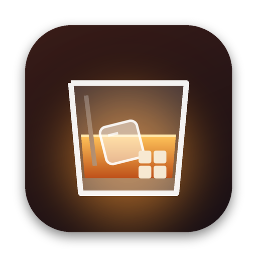

<p align="center">
  
</p>

<h1 align="center">Bourbon</h1>

<p align="center">
  Windows uygulamalarını ve oyunlarını Mac'inizde çalıştırın.<br>
  <em>Run Windows apps and games on your Mac.</em>
</p>

---

Bourbon, [Wine](https://www.winehq.org) üzerine kurulu, modern bir SwiftUI macOS uygulamasıdır.
Her Windows programını kendi **şişesinde** (bağımsız bir Wine ön eki) tutar; Windows sürümünü,
DXVK'yi, MSync'i, Retina modunu ve ortam değişkenlerini tek bir yerden ayarlamanızı sağlar.

Bourbon, [Whisky](https://github.com/Whisky-App/Whisky)'den ilham alır. Whisky'nin
şişe yaklaşımı ve Wine ortam ayarları burada sıfırdan, test edilebilir bir çekirdekle
yeniden yazılmıştır. Whisky gibi Bourbon da **GNU GPL v3** lisanslıdır.

## Özellikler

- **Şişeler**: oluşturma, yeniden adlandırma, çoğaltma, Çöp Sepetine taşıma; renk ve simge seçimi.
- **Kitaplık**: şişedeki `.exe` dosyalarını otomatik bulur, kaldırıcıları ve yardımcı araçları gizler,
  arama, “son oynananlar” sıralaması ve sabitleme sunar.
- **Çalıştırma**: dosya seçerek, sürükle-bırak ile ya da Finder'da “Birlikte Aç → Bourbon” ile
  `.exe`, `.msi` ve `.bat` çalıştırma.
- **Ayarlar (Denetçi)**: Windows XP–11, MSync/ESync, DXVK (+ async, HUD), Metal HUD, Retina modu,
  Rosetta AVX, günlük düzeyi, ortam değişkenleri.
- **Program başına seçenekler**: argümanlar, dil (ör. `ja_JP.UTF-8`), ortam değişkenleri.
- **Araçlar**: winecfg, Kayıt Defteri, Görev Yöneticisi, Denetim Masası, Komut İstemi, Winetricks.
- **Kurulum sihirbazı**: Rosetta 2 kontrolü/kurulumu, mevcut Wine kurulumlarını bulma
  (Gcenx “Wine Stable.app”, Homebrew, Whisky kitaplıkları) veya en güncel Wine'ı indirme.
- **2027 arayüzü**: macOS 26'da sistemin Liquid Glass malzemesi, daha eski sürümlerde aynı
  hiyerarşiyi koruyan buzlu cam görünümü; Türkçe ve İngilizce yerelleştirme.

## İndirme

Hazır derlenmiş, ad-hoc imzalı sürümler [Releases](https://github.com/evrenbetimen/bourbon/releases) sayfasındadır. Uygulama noter onaylı olmadığı için ilk açılışta sağ tıklayıp **Aç**'ı seçin ya da `xattr -dr com.apple.quarantine /Applications/Bourbon.app` komutunu çalıştırın.

Yeni sürüm yayınlamak için `project.yml` içindeki `MARKETING_VERSION` değerini güncelleyip `v1.2.3` biçiminde bir etiket gönderin ya da **Release** iş akışını elle çalıştırın. İş akışı evrensel bir `.app` derler, ad-hoc imzalar, açılışını dener ve `.dmg`, `.zip` ile `SHA256SUMS.txt` dosyalarını yayınlar.

## Gereksinimler

- macOS 14 Sonoma veya üstü (Liquid Glass için macOS 26)
- Apple çipli Mac'lerde Rosetta 2 (sihirbaz kurar)
- Derlemek için Xcode 16+ ve [XcodeGen](https://github.com/yonaskolb/XcodeGen)

## Derleme

```sh
brew install xcodegen
xcodegen generate
open Bourbon.xcodeproj
```

## Proje yapısı

| Yol | İçerik |
| --- | --- |
| `BourbonKit/` | Arayüzden bağımsız çekirdek (Swift paketi): şişe deposu, ayarlar, Wine ortamı ve komutları, çalışma zamanı bulucu, PE başlık ayrıştırıcı, program tarayıcı, winetricks |
| `App/Sources/` | SwiftUI uygulaması |
| `App/UITests/` | XCUITest uçtan uca testleri |
| `scripts/` | QC betikleri (yerelleştirme ve depo kuralları) |

## Kalite güvencesi (QA) ve kalite kontrol (QC)

Her pull request'te GitHub Actions üç iş çalıştırır:

1. **QA · BourbonKit birim testleri**: `swift test` ile 90+ test, kapsam raporu iş özetine yazılır.
2. **QA · Uygulama derlemesi ve UI testleri**: XcodeGen ile proje üretilir, uygulama derlenir ve
   XCUITest'ler (şişe oluşturma, ad doğrulama, kitaplık, denetçi ayarlarının kalıcılığı, dosya
   seçici, kurulum sihirbazı) çalışır. UI testleri `-UITestMode` ile geçici bir klasörde, gerçek
   Wine yerine simüle edilmiş süreçlerle çalışır.
3. **QC · Lint ve yerelleştirme**: koddaki her kullanıcı metninin Türkçe çevirisi olduğunu,
   lisans/atıf bilgisinin yerinde olduğunu, `try!`, `print()` ve `fatalError()` kullanılmadığını
   ve UI testlerinin kullandığı erişilebilirlik kimliklerinin uygulamada bulunduğunu doğrular.

Yerelde:

```sh
swift test --package-path BourbonKit
python3 scripts/check_localization.py
python3 scripts/check_repository.py
xcodebuild test -project Bourbon.xcodeproj -scheme Bourbon -destination 'platform=macOS'
```

## Teşekkürler

- [Whisky](https://github.com/Whisky-App/Whisky): Isaac Marovitz ve katkıcıları (GPL-3.0)
- [Wine](https://www.winehq.org), [DXVK](https://github.com/doitsujin/dxvk),
  [MoltenVK](https://github.com/KhronosGroup/MoltenVK),
  [winetricks](https://github.com/Winetricks/winetricks)
- macOS Wine derlemeleri: [Gcenx/macOS_Wine_builds](https://github.com/Gcenx/macOS_Wine_builds)

## Lisans

Bourbon, GNU General Public License v3.0 ile lisanslanmıştır. Ayrıntılar için [LICENSE](LICENSE).
